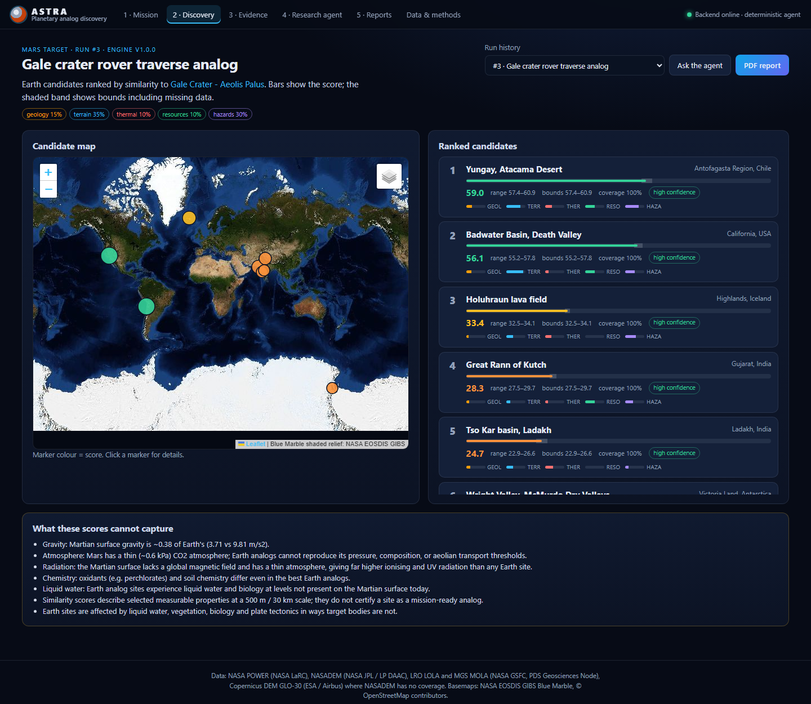
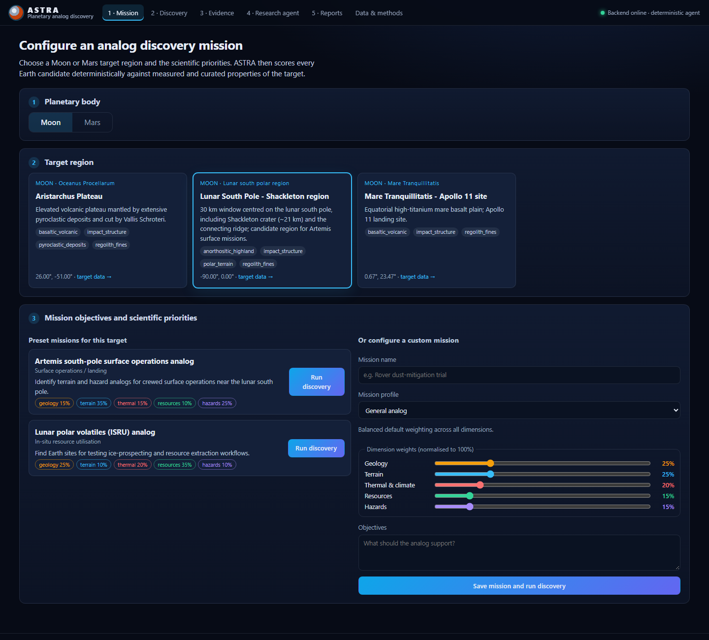
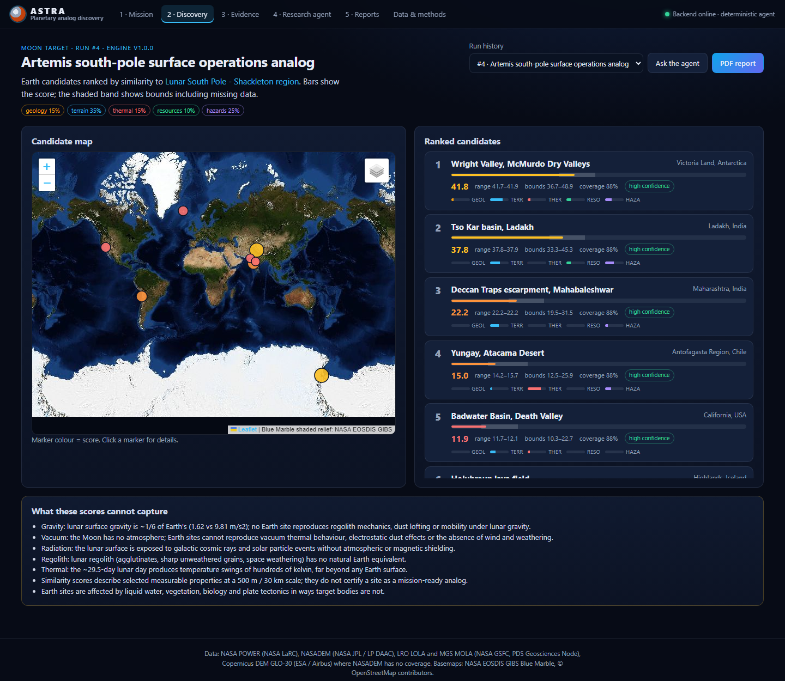
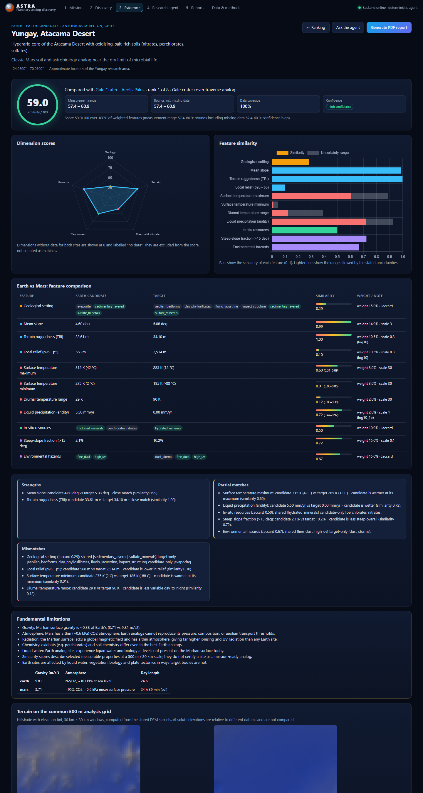
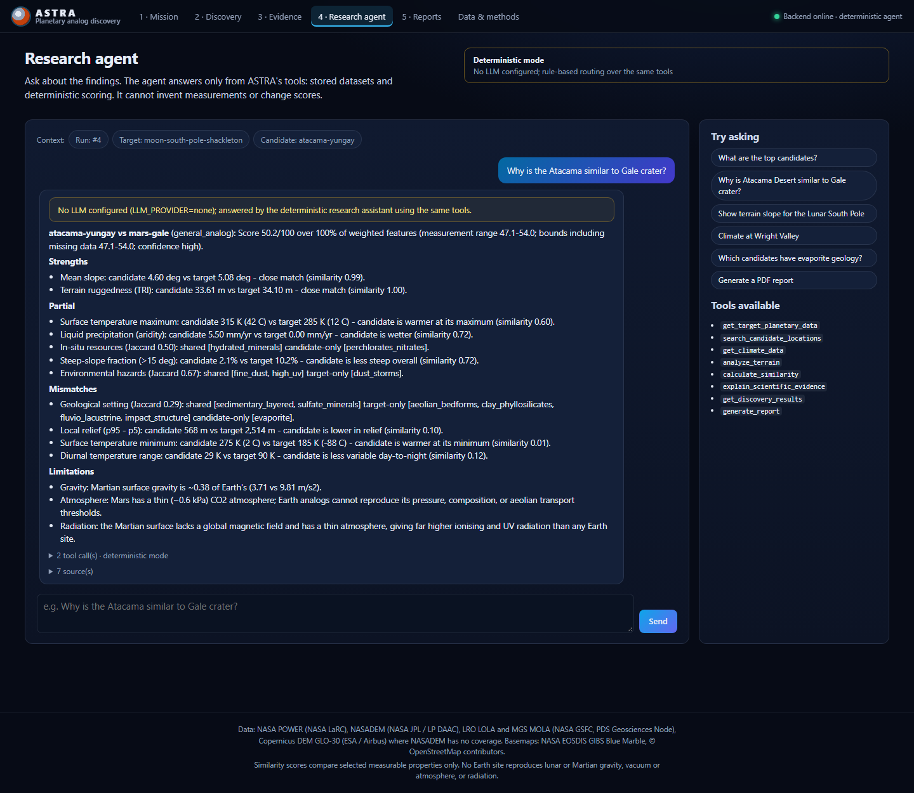
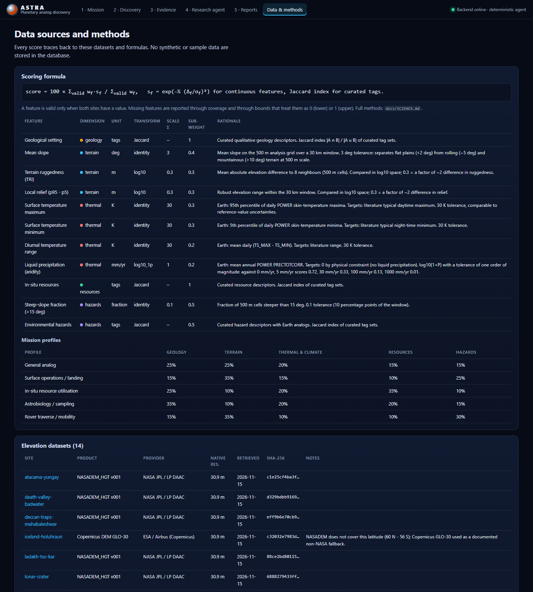
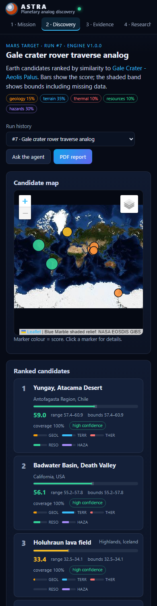

# ASTRA — Autonomous Scientific Terrain Research & Analysis

ASTRA finds and ranks Earth locations whose terrain, thermal environment,
geology, resources and hazards resemble selected Moon and Mars regions. It is a
scientific research tool:

- Every number traces back to a real NASA dataset, a cited literature value or a
  documented, deterministic calculation.
- Missing data is never counted as a match.
- The fundamental differences Earth cannot reproduce (gravity, vacuum or
  atmosphere, radiation) are shown next to every result.



## What it does

1. **Choose a target.** Pick the Moon or Mars, then a target region: the lunar
   south pole (Shackleton), the Apollo 11 site, the Aristarchus Plateau, Jezero,
   Gale or Meridiani.
2. **Configure the mission.** Select a profile (surface operations, ISRU,
   astrobiology, rover traverse, general) or set custom dimension weights.
3. **Run discovery.** ASTRA scores 8 Earth candidates and shows them on a map
   with a transparent ranking: score, measurement range, missing-data bounds,
   coverage and confidence.
4. **Inspect the evidence.** Open a location to see the dimension radar, the
   feature-by-feature comparison, hillshades of both sites on a common 500 m
   grid, and every measurement with its provenance.
5. **Ask the research agent.** It answers through validated tools over stored
   data. Claude is used when configured; otherwise a deterministic assistant
   answers with the same tools.
6. **Generate a PDF report.** Reports include the ranking, evidence, terrain
   images, data provenance with SHA-256 checksums, methods, limitations and
   references.

## Data actually used

All of the following were downloaded for this repository and live in
`datasets/` with provenance sidecars:

| Data | Source | Coverage in ASTRA |
|---|---|---|
| Earth elevation | **NASADEM_HGT v001** (NASA JPL / LP DAAC), via Microsoft Planetary Computer COGs | 6 candidates, 30 km windows at ~30 m |
| Earth elevation (fallback) | **Copernicus DEM GLO-30** (ESA / Airbus — *not NASA*) | Iceland (64.9 N) and McMurdo (77.5 S), which are outside NASADEM's 60 N–56 S range |
| Earth climate | **NASA POWER Daily API** (skin temperature, precipitation, humidity, irradiance, wind), 2020–2023 | 8 candidates, 1461 days each |
| Moon elevation | **LRO LOLA LDEM_64** (473.8 m) and **LDEM_75S_240M** (240 m, south polar stereographic), PDS Geosciences Node | 3 lunar targets |
| Mars elevation | **MGS MOLA MEGDR 128 px/deg** (~463 m), PDS Geosciences Node | 3 Martian targets |
| Target temperatures | Literature reference values: Williams et al. 2017 (Diviner), Vasavada et al. 2017 (REMS) | Apollo 11 and Gale only; recorded as **missing** for the other 4 targets |

The planetary DEM windows are read with HTTP Range requests, so only the needed
rows are transferred. Sanity checks against known elevations pass, for example:
- Badwater Basin: −84 m
- Gale landing site: −4499 m
- Jezero: −2572 m
- Apollo 11: −1923 m

See [`docs/SCIENCE.md`](docs/SCIENCE.md) for all methods, assumptions and
limitations.

## Architecture

```text
frontend/            Vanilla JS SPA (hash router), Leaflet map, Chart.js charts
  js/api.js          REST client
  js/views/*.js      mission, discovery, location (evidence), agent, reports, data
backend/
  main.py            FastAPI app; on startup: schema init -> seed -> ingest; serves frontend
  config.py          .env settings
  database/          SQLAlchemy models (sites, datasets, measurements, missions,
                     discovery runs/results, reports, API cache), schema versioning
  data/              catalog + vocabularies, NASA POWER client, DEM readers,
                     acquisition CLI (network), ingestion (offline)
  science/           resample (common 500 m grid), terrain metrics, feature registry,
                     normalisation, similarity + uncertainty, explanations, profiles,
                     limitations
  services/          discovery runs, comparisons, site serialisation
  agents/            validated tools + tool-calling agent (Claude or deterministic)
  reports/           ReportLab PDF builder
datasets/            real data subsets (GeoTIFF + JSON provenance, POWER JSON)
tests/               pytest: science, data, API, agent
docs/                SCIENCE.md, DEMO.md, screenshots/
```

Data flow:
- `acquire` (network, run once) writes to `datasets/`.
- `ingest` (offline, on startup) fills the `measurements` table with provenance.
- `discovery` scores candidates in pure Python and persists the results.
- The API serves results, comparisons, the agent and PDF reports.

The LLM never computes scores or measurements.

## Run locally

Requirements: Python 3.12+ (developed and tested on 3.14.3, Windows 11).

```sh
python -m venv .venv
# Windows: .venv\Scripts\activate    macOS/Linux: source .venv/bin/activate
pip install -r requirements-dev.txt
cp .env.example .env            # optional; defaults work
python -m backend.main          # http://127.0.0.1:8000
```

Then open:
- `http://127.0.0.1:8000` for the app
- `/docs` for Swagger UI
- `/openapi.json` for the OpenAPI schema

The first start creates `data/astra.db` and ingests `datasets/` in a few seconds.
No network access is needed except for:
- the live climate query
- map tiles and the Leaflet and Chart.js CDNs
- the optional Claude agent

Run the tests:

```sh
python -m pytest -q
```

Re-acquire or refresh the real datasets (network required, ~1–3 min):

```sh
python -m backend.data.acquire --force
python -m backend.data.ingest
```

### Enable the Claude research agent (optional)

```sh
# .env
LLM_PROVIDER=anthropic
LLM_API_KEY=sk-ant-...          # or set ANTHROPIC_API_KEY
LLM_MODEL=claude-opus-5-5       # default
```

The agent uses the official `anthropic` SDK with a manual tool-use loop. It
validates every tool input with Pydantic and treats tool output as data, not
instructions. Requests enable Anthropic's server-side refusal fallback
(`fallbacks="default"`). If the API is unreachable, the app automatically falls
back to the deterministic assistant.

## API

| Method | Path | Purpose |
|---|---|---|
| GET | `/api/health` | App, database and LLM status |
| GET/POST | `/api/missions`, GET `/api/missions/{id}` | Mission presets and custom missions |
| GET | `/api/locations?q=&tag=` | Earth candidates (with curated tags) |
| GET | `/api/targets?body=` | Moon and Mars target regions |
| GET | `/api/location/{id}` | Site detail: measurements with provenance, datasets |
| GET | `/api/location/{id}/terrain` | 500 m analysis grid and hillshade |
| POST | `/api/discovery/run` | Score candidates for a mission (optional weights or candidate subset) |
| GET | `/api/discovery/results/{id}`, `/api/discovery/runs` | Stored ranked results |
| POST | `/api/analysis/compare` | Score one candidate against one target |
| POST | `/api/agent/chat`, GET `/api/agent/status` | Research agent |
| POST | `/api/reports/generate` | Build a PDF report |
| GET | `/api/reports`, `/api/reports/{id}`, `/api/reports/{id}/pdf` | Report metadata and PDF |
| GET | `/api/datasets`, `/api/reference` | Provenance, feature registry, vocabularies, profiles |
| GET | `/api/climate?lat=&lon=&start=&end=` | Live NASA POWER query (validated, cached) |

## Deployment

### Vercel

The project is ready for Vercel's Python runtime:
- `api/index.py` exposes the FastAPI app.
- `vercel.json` routes every path to it and bundles `backend/`, `frontend/` and
  `datasets/`.
- `.vercelignore` keeps `.env` and `.venv` out of the upload.

```sh
npm install -g vercel
vercel login
vercel            # preview deployment; accept the defaults (no build command)
vercel --prod     # production URL
```

Storage on Vercel:
- **Default:** SQLite in `/tmp`. Data is per instance and temporary. It's fine
  for a demo, but a run created on one instance may be missing on another.
- **Recommended:** a hosted Postgres. In the Vercel dashboard, go to Storage,
  create a Neon Postgres database and connect it to the project. That sets
  `DATABASE_URL`, which ASTRA uses automatically through `psycopg`.

Optional environment variables (Project → Settings → Environment Variables):
- `LLM_PROVIDER=anthropic`
- `LLM_API_KEY=...`

PDFs are rebuilt on demand if `/tmp` has been cleared. The first request after
a cold start takes a few seconds, while the datasets are ingested.

### Docker

A `Dockerfile` is included (Python 3.12-slim, uvicorn, `/app/data` volume) but
has **not been built or deployed**:
- Docker is not installed on the development machine.
- No deployment target or credentials were provided.

Use a single worker: SQLite plus the in-process terrain cache. Place it behind
HTTPS and set `ENVIRONMENT=production`.

## Known limitations

- 8 candidates and 6 targets. Coordinates are approximate window centres.
- Target thermal data exist only for Apollo 11 and Gale. The other 4 targets
  have thermal features missing, which lowers coverage and confidence.
- Curated geology, resource and hazard tags are coarse qualitative descriptors,
  not measurements.
- NASA POWER is a ~50 km reanalysis grid. It cannot resolve small features such
  as Lonar crater (~1.8 km), and precipitation in mountainous terrain may be
  biased.
- The 500 m grid and 30 km window hide metre-scale hazards (boulders, small
  craters).
- The Claude agent path is covered by mocked tests only; it was not run against
  the live API, because no key was available during development.

## Acknowledgments

- NASA Langley Research Center POWER Project, funded through the NASA Earth
  Science/Applied Science Program.
- NASA JPL and LP DAAC for NASADEM.
- NASA GSFC, the LRO LOLA and MGS MOLA science teams, and the NASA PDS
  Geosciences Node (Washington University in St. Louis).
- Copernicus DEM GLO-30: © DLR e.V. 2010–2014 and © Airbus Defence and Space
  GmbH 2014–2018, provided under COPERNICUS by the European Union and ESA.
- Microsoft Planetary Computer for cloud-optimised DEM hosting.
- NASA EOSDIS GIBS (Blue Marble basemap) and OpenStreetMap contributors.
- Literature cited in `backend/data/catalog.py` and in each report.

## Screenshots

| | |
|---|---|
|  |  |
|  |  |
|  |  |
